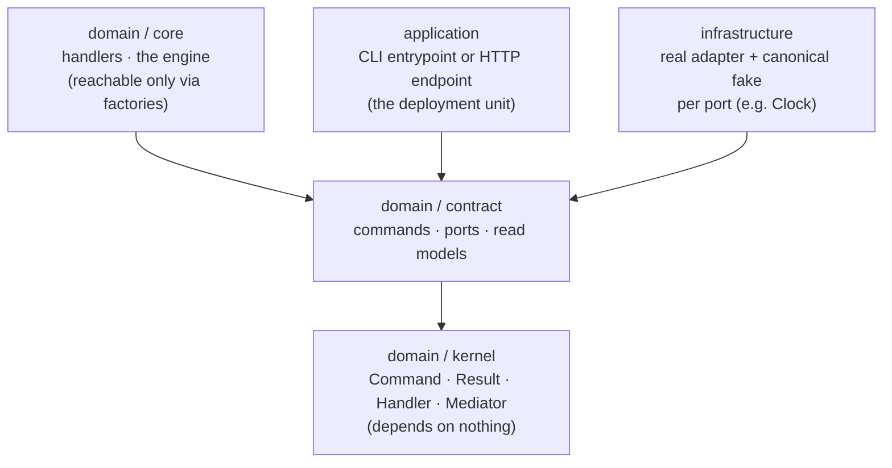

# Stack catalog

A **stack** is a curated greenfield preset: capability tags + verticals
that produce a coherent, runnable project. Pick one and run:

```sh
npx @rgoussu.dev/keel new --stack=<id>
```

Stacks are sugar over the [composition model](../composition.md) —
they spare you naming every tag and vertical by hand, nothing more.

## The matrix

<!-- generated:stack-matrix:begin -->
<!-- Generated by tests/support/generated-docs.ts from the registry, the finder's tree, `keel.dials` and the support tier's facts: edit the generator, not this region. Regenerate with KEEL_UPDATE_GOLDEN=1 pnpm exec vitest run tests/generated-docs.test.ts -->

| Language / framework                                        | CLI                    | HTTP server             | CLI + HTTP server             | Browser SPA      | Product, HTTP server           | Product, CLI + HTTP server         |
| ----------------------------------------------------------- | ---------------------- | ----------------------- | ----------------------------- | ---------------- | ------------------------------ | ---------------------------------- |
| **Java · Quarkus 3** ([docs](jvm.md))                       | `quarkus-cli`          | `quarkus-rest`          | `quarkus-cli-rest`            | —                | `fullstack` ◻                  | `fullstack-cli` ◻                  |
| **Kotlin · Quarkus 3** ([docs](jvm.md))                     | `quarkus-cli-kotlin`   | `quarkus-rest-kotlin`   | `quarkus-cli-rest-kotlin` ◻   | —                | `fullstack-kotlin` ◻           | `fullstack-cli-kotlin` ◻           |
| **Java · Spring Boot 4** ([docs](jvm.md))                   | `spring-cli`           | `spring-rest`           | `spring-cli-rest` ◻           | —                | `fullstack-spring` ◻           | `fullstack-spring-cli` ◻           |
| **Kotlin · Spring Boot 4** ([docs](jvm.md))                 | `spring-cli-kotlin`    | `spring-rest-kotlin`    | `spring-cli-rest-kotlin`      | —                | `fullstack-spring-kotlin` ◻    | `fullstack-spring-cli-kotlin` ◻    |
| **Java · Micronaut 4** ([docs](jvm.md))                     | `micronaut-cli`        | `micronaut-rest`        | `micronaut-cli-rest`          | —                | `fullstack-micronaut` ◻        | `fullstack-micronaut-cli` ◻        |
| **Kotlin · Micronaut 4** ([docs](jvm.md))                   | `micronaut-cli-kotlin` | `micronaut-rest-kotlin` | `micronaut-cli-rest-kotlin` ◻ | —                | `fullstack-micronaut-kotlin` ◻ | `fullstack-micronaut-cli-kotlin` ◻ |
| **Go · stdlib** ([docs](go.md))                             | `go-cli`               | `go-http`               | `go-cli-http`                 | —                | `fullstack-go`                 | `fullstack-go-cli` ◻               |
| **Rust · stdlib / axum** ([docs](rust.md))                  | `rust-cli`             | `rust-http`             | `rust-cli-http`               | —                | `fullstack-rust`               | `fullstack-rust-cli` ◻             |
| **TypeScript · Node** ([docs](ts-http.md))                  | `ts-cli`               | `ts-http`               | `ts-cli-http` ◻               | —                | `fullstack-ts`                 | `fullstack-ts-cli` ◻               |
| **TypeScript · web components** ([docs](web-components.md)) | —                      | —                       | —                             | `web-components` | —                              | —                                  |

A product column's preset pairs the row's preset for that column's entrypoints, in `backend/`, with `web-components` in `frontend/`.

◻ best-effort on its default setting ([support tiers](#support-tiers)): no CI job builds it as `keel new` leaves it; the composition grid in `verify` holds each preset's default setting to its hard invariants, and the weekly, report-only composition sweep reads every setting ·
— the table generates no such preset

<!-- generated:stack-matrix:end -->

The domain trisection is byte-for-byte identical across frameworks per
language — only the application layer and build wiring change. **The
conventions, not the framework, are the product.**

The **CLI + HTTP server** column composes both entrypoints onto one hexagon
instead of picking between them — the same domain, two ways in — and
does so under **either module layout**. Under the modulith each
entrypoint brings a driving adapter into the bounded context
(`user-side/cli`, `user-side/api/…`) as well as its own assembly.

## Module layout

Every single-service stack offers a second structural choice beside
the build system, with `--module-layout` or its prompt:

| Layout            | Shape                                                                                                                                                                                                      |
| ----------------- | ---------------------------------------------------------------------------------------------------------------------------------------------------------------------------------------------------------- |
| `basic` (default) | the flat trisection — one `domain/`, one `application/` per entrypoint. Right while the service holds a single bounded context.                                                                            |
| `modulith`        | one hexagon per bounded context under `modules/<context>/`, shared plumbing under `platform/`, one runnable assembly per delivery typology under `application/`. Modules meet only at `user-side/service`. |

Each family spells the shape in its own idiom — packages and import
paths in Go, Gradle/Maven modules on the JVM — but the dial, the tag
and the flag are the same.
→ [JVM](jvm.md#module-layout) · [Go](go.md#module-layout) ·
[Rust](rust.md#module-layout) · [TypeScript](ts-http.md#module-layout) ·
[web-components](web-components.md#module-layout).

## What each shape installs by default

<!-- generated:stack-defaults:begin -->
<!-- Generated by tests/support/generated-docs.ts from the registry and the composition grid's composite golden: edit the generator, not this region. Regenerate with KEEL_UPDATE_GOLDEN=1 pnpm exec vitest run tests/generated-docs.test.ts -->

| Shape                                                                                                                                                                                                                                           | Verticals installed at bootstrap                                                                                                                                                                                                                                                                                                   |
| ----------------------------------------------------------------------------------------------------------------------------------------------------------------------------------------------------------------------------------------------- | ---------------------------------------------------------------------------------------------------------------------------------------------------------------------------------------------------------------------------------------------------------------------------------------------------------------------------------- |
| CLI                                                                                                                                                                                                                                             | [`vcs`](../verticals/vcs.md) · [`walking-skeleton`](../verticals/walking-skeleton.md) · [`agent-harness`](../verticals/agent-harness.md) · [`code-style`](../verticals/code-style.md) · [`dev-container`](../verticals/dev-container.md)                                                                                           |
| HTTP server                                                                                                                                                                                                                                     | [`vcs`](../verticals/vcs.md) · [`walking-skeleton`](../verticals/walking-skeleton.md) · [`agent-harness`](../verticals/agent-harness.md) · [`code-style`](../verticals/code-style.md) · [`dev-env`](../verticals/dev-env.md) · [`observability`](../verticals/observability.md) · [`dev-container`](../verticals/dev-container.md) |
| CLI + HTTP server                                                                                                                                                                                                                               | [`vcs`](../verticals/vcs.md) · [`walking-skeleton`](../verticals/walking-skeleton.md) · [`agent-harness`](../verticals/agent-harness.md) · [`code-style`](../verticals/code-style.md) · [`dev-env`](../verticals/dev-env.md) · [`observability`](../verticals/observability.md) · [`dev-container`](../verticals/dev-container.md) |
| Browser SPA                                                                                                                                                                                                                                     | [`vcs`](../verticals/vcs.md) · [`walking-skeleton`](../verticals/walking-skeleton.md) · [`agent-harness`](../verticals/agent-harness.md) · [`code-style`](../verticals/code-style.md) · [`dev-container`](../verticals/dev-container.md)                                                                                           |
| Product root (monorepo)                                                                                                                                                                                                                         | [`vcs`](../verticals/vcs.md) · [`fullstack`](../verticals/fullstack.md)                                                                                                                                                                                                                                                            |
| Product `backend/` of `fullstack`, `fullstack-go`, `fullstack-kotlin`, `fullstack-micronaut`, `fullstack-micronaut-kotlin`, `fullstack-rust`, `fullstack-spring`, `fullstack-spring-kotlin`, `fullstack-ts`                                     | the HTTP server row, + [`gateway`](../verticals/gateway.md)                                                                                                                                                                                                                                                                        |
| Product `backend/` of `fullstack-cli`, `fullstack-cli-kotlin`, `fullstack-go-cli`, `fullstack-micronaut-cli`, `fullstack-micronaut-cli-kotlin`, `fullstack-rust-cli`, `fullstack-spring-cli`, `fullstack-spring-cli-kotlin`, `fullstack-ts-cli` | the CLI + HTTP server row, + [`gateway`](../verticals/gateway.md)                                                                                                                                                                                                                                                                  |
| Product `frontend/`                                                                                                                                                                                                                             | the Browser SPA row, + [`gateway`](../verticals/gateway.md)                                                                                                                                                                                                                                                                        |

<!-- generated:stack-defaults:end -->

A shape is the set of entrypoints a preset is driven from — a column
of the matrix above — named here as the `keel new` wizard names it. A
product's services are presets of their own. Under the monorepo layout
a service's version control is the product root's, and the root builds
its image; under polyrepo every service is a repository of its own,
with its own `vcs`, and the root has no glue.

More can be layered on afterwards with `keel add` — see the
[compatibility matrix](../verticals/README.md#compatibility-matrix),
generated, like the table above, from what keel does.

## Support tiers

keel says how far it vouches for each setting it offers. A setting is
a dial cell: one preset on one value of every dial `keel.dials` offers
it — build system, module layout, peer context, repository layout.
Each cell has a tier:

- **first-class**: an e2e suite builds it as `keel new` leaves it, or
  each part of it is proven byte-identical to a part a suite builds;
- **best-effort**: no CI job builds it as `keel new` leaves it; the
  composition grid in `verify` holds each preset's default setting to
  its hard invariants, and the weekly, report-only composition sweep
  reads every setting.

A pairing the table does not generate has no tier: `keel new` refuses
it. A plugin's preset has no tier either, since keel's CI vouches only
for keel's presets.

<!-- generated:support-tiers:begin -->
<!-- Generated by tests/support/generated-docs.ts from the registry, `keel.dials`, the support tier's facts and `tests/support/e2e-roles.ts`: edit the generator, not this region. Regenerate with KEEL_UPDATE_GOLDEN=1 pnpm exec vitest run tests/generated-docs.test.ts -->

✅ first-class: the e2e suite named builds it as `keel new` leaves it, or, for a product's service, builds an identical service ·
◻ best-effort: no CI job builds it as `keel new` leaves it; the composition grid in `verify` holds each preset's default setting to its hard invariants, and the weekly, report-only composition sweep reads every setting; a suite named beside ◻ builds it only after changing it, by `keel add module` or by adding a vertical first ·
— not a setting the preset offers

| Preset                      | Build system | `basic`                                          | `modulith`                                  | `modulith` + peer context                            |
| --------------------------- | ------------ | ------------------------------------------------ | ------------------------------------------- | ---------------------------------------------------- |
| `go-cli`                    | —            | ✅ `walking-skeleton-go`                         | ✅ `modulith-go-cli`                        | ✅ `modulith-go-peer-context`                        |
| `go-cli-http`               | —            | ✅ `combo-basic-go-cli-http`                     | ◻                                           | ◻                                                    |
| `go-http`                   | —            | ✅ `walking-skeleton-go`                         | ✅ `modulith-go-http`                       | ◻                                                    |
| `micronaut-cli`             | `gradle`     | ✅ `walking-skeleton-micronaut-cli`              | ◻ `add-module-micronaut-cli-gradle`         | ✅ `modulith-micronaut-cli-gradle`                   |
| `micronaut-cli`             | `maven`      | ◻                                                | ◻ `add-module-micronaut-cli-maven`          | ✅ `modulith-micronaut-cli-maven`                    |
| `micronaut-cli-kotlin`      | `gradle`     | ✅ `walking-skeleton-micronaut-cli-kotlin`       | ◻ `add-module-micronaut-cli-kotlin-gradle`  | ✅ `modulith-micronaut-cli-kotlin-gradle`            |
| `micronaut-cli-kotlin`      | `maven`      | ◻                                                | ◻ `add-module-micronaut-cli-kotlin-maven`   | ✅ `modulith-micronaut-cli-kotlin-maven`             |
| `micronaut-cli-rest`        | `gradle`     | ✅ `combo-basic-micronaut-cli-rest-gradle`       | ◻                                           | ✅ `combo-modulith-micronaut-cli-rest-gradle`        |
| `micronaut-cli-rest`        | `maven`      | ◻                                                | ◻                                           | ✅ `combo-modulith-micronaut-cli-rest-maven`         |
| `micronaut-cli-rest-kotlin` | `gradle`     | ◻                                                | ◻                                           | ✅ `combo-modulith-micronaut-cli-rest-kotlin-gradle` |
| `micronaut-cli-rest-kotlin` | `maven`      | ✅ `combo-basic-micronaut-cli-rest-kotlin-maven` | ◻                                           | ✅ `combo-modulith-micronaut-cli-rest-kotlin-maven`  |
| `micronaut-rest`            | `gradle`     | ✅ `walking-skeleton-micronaut`                  | ◻ `add-module-micronaut-rest-gradle`        | ✅ `modulith-micronaut-rest-gradle`                  |
| `micronaut-rest`            | `maven`      | ◻                                                | ◻ `add-module-micronaut-rest-maven`         | ✅ `modulith-micronaut-rest-maven`                   |
| `micronaut-rest-kotlin`     | `gradle`     | ✅ `walking-skeleton-micronaut-kotlin`           | ◻ `add-module-micronaut-rest-kotlin-gradle` | ✅ `modulith-micronaut-rest-kotlin-gradle`           |
| `micronaut-rest-kotlin`     | `maven`      | ◻                                                | ◻ `add-module-micronaut-rest-kotlin-maven`  | ✅ `modulith-micronaut-rest-kotlin-maven`            |
| `quarkus-cli`               | `gradle`     | ✅ `walking-skeleton`                            | ◻ `add-module-quarkus-cli-gradle`           | ✅ `modulith-quarkus-cli-gradle`                     |
| `quarkus-cli`               | `maven`      | ◻                                                | ◻ `add-module-quarkus-cli-maven`            | ✅ `modulith-quarkus-cli-maven`                      |
| `quarkus-cli-kotlin`        | `gradle`     | ✅ `walking-skeleton-quarkus-cli-kotlin`         | ◻ `add-module-quarkus-cli-kotlin-gradle`    | ✅ `modulith-quarkus-cli-kotlin-gradle`              |
| `quarkus-cli-kotlin`        | `maven`      | ◻                                                | ◻ `add-module-quarkus-cli-kotlin-maven`     | ✅ `modulith-quarkus-cli-kotlin-maven`               |
| `quarkus-cli-rest`          | `gradle`     | ✅ `combo-basic-quarkus-cli-rest-gradle`         | ◻                                           | ✅ `combo-modulith-quarkus-cli-rest-gradle`          |
| `quarkus-cli-rest`          | `maven`      | ◻                                                | ◻                                           | ✅ `combo-modulith-quarkus-cli-rest-maven`           |
| `quarkus-cli-rest-kotlin`   | `gradle`     | ◻                                                | ◻                                           | ✅ `combo-modulith-quarkus-cli-rest-kotlin-gradle`   |
| `quarkus-cli-rest-kotlin`   | `maven`      | ✅ `combo-basic-quarkus-cli-rest-kotlin-maven`   | ◻                                           | ✅ `combo-modulith-quarkus-cli-rest-kotlin-maven`    |
| `quarkus-rest`              | `gradle`     | ✅ `walking-skeleton-rest`                       | ✅ `modulith-baseline`                      | ✅ `modulith-quarkus-rest-gradle`                    |
| `quarkus-rest`              | `maven`      | ◻                                                | ◻ `add-module-quarkus-rest-maven`           | ✅ `modulith-quarkus-rest-maven`                     |
| `quarkus-rest-kotlin`       | `gradle`     | ✅ `walking-skeleton-kotlin`                     | ◻ `add-module-quarkus-rest-kotlin-gradle`   | ✅ `modulith-quarkus-rest-kotlin-gradle`             |
| `quarkus-rest-kotlin`       | `maven`      | ◻                                                | ◻ `add-module-quarkus-rest-kotlin-maven`    | ✅ `modulith-quarkus-rest-kotlin-maven`              |
| `rust-cli`                  | —            | ✅ `walking-skeleton-rust`                       | ✅ `modulith-rust-cli`                      | ✅ `modulith-rust-peer-context`                      |
| `rust-cli-http`             | —            | ✅ `combo-basic-rust-cli-http`                   | ◻                                           | ◻                                                    |
| `rust-http`                 | —            | ✅ `walking-skeleton-rust`                       | ✅ `modulith-rust-http`                     | ◻                                                    |
| `spring-cli`                | `gradle`     | ✅ `walking-skeleton-spring-cli`                 | ◻ `add-module-spring-cli-gradle`            | ✅ `modulith-spring-cli-gradle`                      |
| `spring-cli`                | `maven`      | ◻                                                | ◻ `add-module-spring-cli-maven`             | ✅ `modulith-spring-cli-maven`                       |
| `spring-cli-kotlin`         | `gradle`     | ✅ `walking-skeleton-spring-cli-kotlin`          | ◻ `add-module-spring-cli-kotlin-gradle`     | ✅ `modulith-spring-cli-kotlin-gradle`               |
| `spring-cli-kotlin`         | `maven`      | ◻                                                | ◻ `add-module-spring-cli-kotlin-maven`      | ✅ `modulith-spring-cli-kotlin-maven`                |
| `spring-cli-rest`           | `gradle`     | ◻                                                | ◻                                           | ✅ `combo-modulith-spring-cli-rest-gradle`           |
| `spring-cli-rest`           | `maven`      | ✅ `combo-basic-spring-cli-rest-maven`           | ◻                                           | ✅ `combo-modulith-spring-cli-rest-maven`            |
| `spring-cli-rest-kotlin`    | `gradle`     | ✅ `combo-basic-spring-cli-rest-kotlin-gradle`   | ◻                                           | ✅ `combo-modulith-spring-cli-rest-kotlin-gradle`    |
| `spring-cli-rest-kotlin`    | `maven`      | ◻                                                | ◻                                           | ✅ `combo-modulith-spring-cli-rest-kotlin-maven`     |
| `spring-rest`               | `gradle`     | ✅ `walking-skeleton-spring`                     | ◻ `add-module-spring-rest-gradle`           | ✅ `modulith-spring-rest-gradle`                     |
| `spring-rest`               | `maven`      | ◻                                                | ◻ `add-module-spring-rest-maven`            | ✅ `modulith-spring-rest-maven`                      |
| `spring-rest-kotlin`        | `gradle`     | ✅ `walking-skeleton-spring-kotlin`              | ◻ `add-module-spring-rest-kotlin-gradle`    | ✅ `modulith-spring-rest-kotlin-gradle`              |
| `spring-rest-kotlin`        | `maven`      | ◻                                                | ◻ `add-module-spring-rest-kotlin-maven`     | ✅ `modulith-spring-rest-kotlin-maven`               |
| `ts-cli`                    | `npm`        | ✅ `ts-cli-walking-skeleton`                     | ✅ `modulith-ts-cli-npm`                    | ◻                                                    |
| `ts-cli`                    | `pnpm`       | ✅ `ts-cli-walking-skeleton`                     | ✅ `modulith-ts-cli-pnpm`                   | ◻                                                    |
| `ts-cli-http`               | `npm`        | ◻                                                | ◻                                           | ✅ `combo-modulith-ts-cli-http-npm`                  |
| `ts-cli-http`               | `pnpm`       | ✅ `combo-basic-ts-cli-http-pnpm`                | ◻                                           | ✅ `combo-modulith-ts-cli-http-pnpm`                 |
| `ts-http`                   | `npm`        | ✅ `ts-walking-skeleton`                         | ✅ `modulith-ts-http-npm`                   | ✅ `modulith-ts-peer-context`                        |
| `ts-http`                   | `pnpm`       | ✅ `ts-walking-skeleton`                         | ✅ `modulith-ts-http-pnpm`                  | ◻                                                    |
| `web-components`            | `npm`        | ✅ `wc-walking-skeleton`                         | ✅ `modulith-web-components-npm`            | ✅ `modulith-wc-peer-context`                        |
| `web-components`            | `pnpm`       | ◻                                                | ✅ `modulith-web-components-pnpm`           | ◻                                                    |

A product is first-class where every service is. A service is proven where a suite builds it, on this product or on any other whose service has the same files.

| Product                            | Layout   | Build systems                   | `backend/`          | `frontend/`    |
| ---------------------------------- | -------- | ------------------------------- | ------------------- | -------------- |
| `fullstack` ◻                      | monorepo | `backend=gradle, frontend=npm`  | ◻                   | ✅ `fullstack` |
| `fullstack` ◻                      | monorepo | `backend=maven, frontend=npm`   | ◻                   | ✅ `fullstack` |
| `fullstack` ◻                      | monorepo | `backend=gradle, frontend=pnpm` | ◻                   | ◻              |
| `fullstack` ◻                      | monorepo | `backend=maven, frontend=pnpm`  | ◻                   | ◻              |
| `fullstack` ◻                      | polyrepo | `backend=gradle, frontend=npm`  | ◻                   | ◻              |
| `fullstack` ◻                      | polyrepo | `backend=maven, frontend=npm`   | ◻                   | ◻              |
| `fullstack` ◻                      | polyrepo | `backend=gradle, frontend=pnpm` | ◻                   | ◻              |
| `fullstack` ◻                      | polyrepo | `backend=maven, frontend=pnpm`  | ◻                   | ◻              |
| `fullstack-cli` ◻                  | monorepo | `backend=gradle, frontend=npm`  | ◻                   | ✅ `fullstack` |
| `fullstack-cli` ◻                  | monorepo | `backend=maven, frontend=npm`   | ◻                   | ✅ `fullstack` |
| `fullstack-cli` ◻                  | monorepo | `backend=gradle, frontend=pnpm` | ◻                   | ◻              |
| `fullstack-cli` ◻                  | monorepo | `backend=maven, frontend=pnpm`  | ◻                   | ◻              |
| `fullstack-cli` ◻                  | polyrepo | `backend=gradle, frontend=npm`  | ◻                   | ◻              |
| `fullstack-cli` ◻                  | polyrepo | `backend=maven, frontend=npm`   | ◻                   | ◻              |
| `fullstack-cli` ◻                  | polyrepo | `backend=gradle, frontend=pnpm` | ◻                   | ◻              |
| `fullstack-cli` ◻                  | polyrepo | `backend=maven, frontend=pnpm`  | ◻                   | ◻              |
| `fullstack-cli-kotlin` ◻           | monorepo | `backend=gradle, frontend=npm`  | ◻                   | ✅ `fullstack` |
| `fullstack-cli-kotlin` ◻           | monorepo | `backend=maven, frontend=npm`   | ◻                   | ✅ `fullstack` |
| `fullstack-cli-kotlin` ◻           | monorepo | `backend=gradle, frontend=pnpm` | ◻                   | ◻              |
| `fullstack-cli-kotlin` ◻           | monorepo | `backend=maven, frontend=pnpm`  | ◻                   | ◻              |
| `fullstack-cli-kotlin` ◻           | polyrepo | `backend=gradle, frontend=npm`  | ◻                   | ◻              |
| `fullstack-cli-kotlin` ◻           | polyrepo | `backend=maven, frontend=npm`   | ◻                   | ◻              |
| `fullstack-cli-kotlin` ◻           | polyrepo | `backend=gradle, frontend=pnpm` | ◻                   | ◻              |
| `fullstack-cli-kotlin` ◻           | polyrepo | `backend=maven, frontend=pnpm`  | ◻                   | ◻              |
| `fullstack-go` ✅                  | monorepo | `frontend=npm`                  | ✅ `fullstack-go`   | ✅ `fullstack` |
| `fullstack-go` ◻                   | monorepo | `frontend=pnpm`                 | ✅ `fullstack-go`   | ◻              |
| `fullstack-go` ◻                   | polyrepo | `frontend=npm`                  | ◻                   | ◻              |
| `fullstack-go` ◻                   | polyrepo | `frontend=pnpm`                 | ◻                   | ◻              |
| `fullstack-go-cli` ◻               | monorepo | `frontend=npm`                  | ◻                   | ✅ `fullstack` |
| `fullstack-go-cli` ◻               | monorepo | `frontend=pnpm`                 | ◻                   | ◻              |
| `fullstack-go-cli` ◻               | polyrepo | `frontend=npm`                  | ◻                   | ◻              |
| `fullstack-go-cli` ◻               | polyrepo | `frontend=pnpm`                 | ◻                   | ◻              |
| `fullstack-kotlin` ◻               | monorepo | `backend=gradle, frontend=npm`  | ◻                   | ✅ `fullstack` |
| `fullstack-kotlin` ◻               | monorepo | `backend=maven, frontend=npm`   | ◻                   | ✅ `fullstack` |
| `fullstack-kotlin` ◻               | monorepo | `backend=gradle, frontend=pnpm` | ◻                   | ◻              |
| `fullstack-kotlin` ◻               | monorepo | `backend=maven, frontend=pnpm`  | ◻                   | ◻              |
| `fullstack-kotlin` ◻               | polyrepo | `backend=gradle, frontend=npm`  | ◻                   | ◻              |
| `fullstack-kotlin` ◻               | polyrepo | `backend=maven, frontend=npm`   | ◻                   | ◻              |
| `fullstack-kotlin` ◻               | polyrepo | `backend=gradle, frontend=pnpm` | ◻                   | ◻              |
| `fullstack-kotlin` ◻               | polyrepo | `backend=maven, frontend=pnpm`  | ◻                   | ◻              |
| `fullstack-micronaut` ◻            | monorepo | `backend=gradle, frontend=npm`  | ◻                   | ✅ `fullstack` |
| `fullstack-micronaut` ◻            | monorepo | `backend=maven, frontend=npm`   | ◻                   | ✅ `fullstack` |
| `fullstack-micronaut` ◻            | monorepo | `backend=gradle, frontend=pnpm` | ◻                   | ◻              |
| `fullstack-micronaut` ◻            | monorepo | `backend=maven, frontend=pnpm`  | ◻                   | ◻              |
| `fullstack-micronaut` ◻            | polyrepo | `backend=gradle, frontend=npm`  | ◻                   | ◻              |
| `fullstack-micronaut` ◻            | polyrepo | `backend=maven, frontend=npm`   | ◻                   | ◻              |
| `fullstack-micronaut` ◻            | polyrepo | `backend=gradle, frontend=pnpm` | ◻                   | ◻              |
| `fullstack-micronaut` ◻            | polyrepo | `backend=maven, frontend=pnpm`  | ◻                   | ◻              |
| `fullstack-micronaut-cli` ◻        | monorepo | `backend=gradle, frontend=npm`  | ◻                   | ✅ `fullstack` |
| `fullstack-micronaut-cli` ◻        | monorepo | `backend=maven, frontend=npm`   | ◻                   | ✅ `fullstack` |
| `fullstack-micronaut-cli` ◻        | monorepo | `backend=gradle, frontend=pnpm` | ◻                   | ◻              |
| `fullstack-micronaut-cli` ◻        | monorepo | `backend=maven, frontend=pnpm`  | ◻                   | ◻              |
| `fullstack-micronaut-cli` ◻        | polyrepo | `backend=gradle, frontend=npm`  | ◻                   | ◻              |
| `fullstack-micronaut-cli` ◻        | polyrepo | `backend=maven, frontend=npm`   | ◻                   | ◻              |
| `fullstack-micronaut-cli` ◻        | polyrepo | `backend=gradle, frontend=pnpm` | ◻                   | ◻              |
| `fullstack-micronaut-cli` ◻        | polyrepo | `backend=maven, frontend=pnpm`  | ◻                   | ◻              |
| `fullstack-micronaut-cli-kotlin` ◻ | monorepo | `backend=gradle, frontend=npm`  | ◻                   | ✅ `fullstack` |
| `fullstack-micronaut-cli-kotlin` ◻ | monorepo | `backend=maven, frontend=npm`   | ◻                   | ✅ `fullstack` |
| `fullstack-micronaut-cli-kotlin` ◻ | monorepo | `backend=gradle, frontend=pnpm` | ◻                   | ◻              |
| `fullstack-micronaut-cli-kotlin` ◻ | monorepo | `backend=maven, frontend=pnpm`  | ◻                   | ◻              |
| `fullstack-micronaut-cli-kotlin` ◻ | polyrepo | `backend=gradle, frontend=npm`  | ◻                   | ◻              |
| `fullstack-micronaut-cli-kotlin` ◻ | polyrepo | `backend=maven, frontend=npm`   | ◻                   | ◻              |
| `fullstack-micronaut-cli-kotlin` ◻ | polyrepo | `backend=gradle, frontend=pnpm` | ◻                   | ◻              |
| `fullstack-micronaut-cli-kotlin` ◻ | polyrepo | `backend=maven, frontend=pnpm`  | ◻                   | ◻              |
| `fullstack-micronaut-kotlin` ◻     | monorepo | `backend=gradle, frontend=npm`  | ◻                   | ✅ `fullstack` |
| `fullstack-micronaut-kotlin` ◻     | monorepo | `backend=maven, frontend=npm`   | ◻                   | ✅ `fullstack` |
| `fullstack-micronaut-kotlin` ◻     | monorepo | `backend=gradle, frontend=pnpm` | ◻                   | ◻              |
| `fullstack-micronaut-kotlin` ◻     | monorepo | `backend=maven, frontend=pnpm`  | ◻                   | ◻              |
| `fullstack-micronaut-kotlin` ◻     | polyrepo | `backend=gradle, frontend=npm`  | ◻                   | ◻              |
| `fullstack-micronaut-kotlin` ◻     | polyrepo | `backend=maven, frontend=npm`   | ◻                   | ◻              |
| `fullstack-micronaut-kotlin` ◻     | polyrepo | `backend=gradle, frontend=pnpm` | ◻                   | ◻              |
| `fullstack-micronaut-kotlin` ◻     | polyrepo | `backend=maven, frontend=pnpm`  | ◻                   | ◻              |
| `fullstack-rust` ✅                | monorepo | `frontend=npm`                  | ✅ `fullstack-rust` | ✅ `fullstack` |
| `fullstack-rust` ◻                 | monorepo | `frontend=pnpm`                 | ✅ `fullstack-rust` | ◻              |
| `fullstack-rust` ◻                 | polyrepo | `frontend=npm`                  | ◻                   | ◻              |
| `fullstack-rust` ◻                 | polyrepo | `frontend=pnpm`                 | ◻                   | ◻              |
| `fullstack-rust-cli` ◻             | monorepo | `frontend=npm`                  | ◻                   | ✅ `fullstack` |
| `fullstack-rust-cli` ◻             | monorepo | `frontend=pnpm`                 | ◻                   | ◻              |
| `fullstack-rust-cli` ◻             | polyrepo | `frontend=npm`                  | ◻                   | ◻              |
| `fullstack-rust-cli` ◻             | polyrepo | `frontend=pnpm`                 | ◻                   | ◻              |
| `fullstack-spring` ◻               | monorepo | `backend=gradle, frontend=npm`  | ◻                   | ✅ `fullstack` |
| `fullstack-spring` ◻               | monorepo | `backend=maven, frontend=npm`   | ◻                   | ✅ `fullstack` |
| `fullstack-spring` ◻               | monorepo | `backend=gradle, frontend=pnpm` | ◻                   | ◻              |
| `fullstack-spring` ◻               | monorepo | `backend=maven, frontend=pnpm`  | ◻                   | ◻              |
| `fullstack-spring` ◻               | polyrepo | `backend=gradle, frontend=npm`  | ◻                   | ◻              |
| `fullstack-spring` ◻               | polyrepo | `backend=maven, frontend=npm`   | ◻                   | ◻              |
| `fullstack-spring` ◻               | polyrepo | `backend=gradle, frontend=pnpm` | ◻                   | ◻              |
| `fullstack-spring` ◻               | polyrepo | `backend=maven, frontend=pnpm`  | ◻                   | ◻              |
| `fullstack-spring-cli` ◻           | monorepo | `backend=gradle, frontend=npm`  | ◻                   | ✅ `fullstack` |
| `fullstack-spring-cli` ◻           | monorepo | `backend=maven, frontend=npm`   | ◻                   | ✅ `fullstack` |
| `fullstack-spring-cli` ◻           | monorepo | `backend=gradle, frontend=pnpm` | ◻                   | ◻              |
| `fullstack-spring-cli` ◻           | monorepo | `backend=maven, frontend=pnpm`  | ◻                   | ◻              |
| `fullstack-spring-cli` ◻           | polyrepo | `backend=gradle, frontend=npm`  | ◻                   | ◻              |
| `fullstack-spring-cli` ◻           | polyrepo | `backend=maven, frontend=npm`   | ◻                   | ◻              |
| `fullstack-spring-cli` ◻           | polyrepo | `backend=gradle, frontend=pnpm` | ◻                   | ◻              |
| `fullstack-spring-cli` ◻           | polyrepo | `backend=maven, frontend=pnpm`  | ◻                   | ◻              |
| `fullstack-spring-cli-kotlin` ◻    | monorepo | `backend=gradle, frontend=npm`  | ◻                   | ✅ `fullstack` |
| `fullstack-spring-cli-kotlin` ◻    | monorepo | `backend=maven, frontend=npm`   | ◻                   | ✅ `fullstack` |
| `fullstack-spring-cli-kotlin` ◻    | monorepo | `backend=gradle, frontend=pnpm` | ◻                   | ◻              |
| `fullstack-spring-cli-kotlin` ◻    | monorepo | `backend=maven, frontend=pnpm`  | ◻                   | ◻              |
| `fullstack-spring-cli-kotlin` ◻    | polyrepo | `backend=gradle, frontend=npm`  | ◻                   | ◻              |
| `fullstack-spring-cli-kotlin` ◻    | polyrepo | `backend=maven, frontend=npm`   | ◻                   | ◻              |
| `fullstack-spring-cli-kotlin` ◻    | polyrepo | `backend=gradle, frontend=pnpm` | ◻                   | ◻              |
| `fullstack-spring-cli-kotlin` ◻    | polyrepo | `backend=maven, frontend=pnpm`  | ◻                   | ◻              |
| `fullstack-spring-kotlin` ◻        | monorepo | `backend=gradle, frontend=npm`  | ◻                   | ✅ `fullstack` |
| `fullstack-spring-kotlin` ◻        | monorepo | `backend=maven, frontend=npm`   | ◻                   | ✅ `fullstack` |
| `fullstack-spring-kotlin` ◻        | monorepo | `backend=gradle, frontend=pnpm` | ◻                   | ◻              |
| `fullstack-spring-kotlin` ◻        | monorepo | `backend=maven, frontend=pnpm`  | ◻                   | ◻              |
| `fullstack-spring-kotlin` ◻        | polyrepo | `backend=gradle, frontend=npm`  | ◻                   | ◻              |
| `fullstack-spring-kotlin` ◻        | polyrepo | `backend=maven, frontend=npm`   | ◻                   | ◻              |
| `fullstack-spring-kotlin` ◻        | polyrepo | `backend=gradle, frontend=pnpm` | ◻                   | ◻              |
| `fullstack-spring-kotlin` ◻        | polyrepo | `backend=maven, frontend=pnpm`  | ◻                   | ◻              |
| `fullstack-ts` ✅                  | monorepo | `backend=npm, frontend=npm`     | ✅ `fullstack-ts`   | ✅ `fullstack` |
| `fullstack-ts` ◻                   | monorepo | `backend=pnpm, frontend=npm`    | ◻                   | ✅ `fullstack` |
| `fullstack-ts` ◻                   | monorepo | `backend=npm, frontend=pnpm`    | ✅ `fullstack-ts`   | ◻              |
| `fullstack-ts` ◻                   | monorepo | `backend=pnpm, frontend=pnpm`   | ◻                   | ◻              |
| `fullstack-ts` ◻                   | polyrepo | `backend=npm, frontend=npm`     | ◻                   | ◻              |
| `fullstack-ts` ◻                   | polyrepo | `backend=pnpm, frontend=npm`    | ◻                   | ◻              |
| `fullstack-ts` ◻                   | polyrepo | `backend=npm, frontend=pnpm`    | ◻                   | ◻              |
| `fullstack-ts` ◻                   | polyrepo | `backend=pnpm, frontend=pnpm`   | ◻                   | ◻              |
| `fullstack-ts-cli` ◻               | monorepo | `backend=npm, frontend=npm`     | ◻                   | ✅ `fullstack` |
| `fullstack-ts-cli` ◻               | monorepo | `backend=pnpm, frontend=npm`    | ◻                   | ✅ `fullstack` |
| `fullstack-ts-cli` ◻               | monorepo | `backend=npm, frontend=pnpm`    | ◻                   | ◻              |
| `fullstack-ts-cli` ◻               | monorepo | `backend=pnpm, frontend=pnpm`   | ◻                   | ◻              |
| `fullstack-ts-cli` ◻               | polyrepo | `backend=npm, frontend=npm`     | ◻                   | ◻              |
| `fullstack-ts-cli` ◻               | polyrepo | `backend=pnpm, frontend=npm`    | ◻                   | ◻              |
| `fullstack-ts-cli` ◻               | polyrepo | `backend=npm, frontend=pnpm`    | ◻                   | ◻              |
| `fullstack-ts-cli` ◻               | polyrepo | `backend=pnpm, frontend=pnpm`   | ◻                   | ◻              |

A cell scaffolded with `--no-agent-harness` has the tier of its twin with the harness. It is that twin less the agent files, and `verify` checks it on every cell.

No cell's deployment glue is ever built: no suite builds a `Dockerfile` into an image or runs a product's `compose.yaml`. First-class vouches for the code, not for its deployment.

<!-- generated:support-tiers:end -->

## Prerequisites at a glance

keel itself needs **Node 22+** (it runs via `npx`). Each stack then
shells out to your local toolchain during the bootstrap — the exact
list, per stack, is on each stack page:

| Stack family                                      | Required on PATH                                                                |
| ------------------------------------------------- | ------------------------------------------------------------------------------- |
| [JVM](jvm.md#prerequisites)                       | `git`, JDK 25, and `gradle` _or_ `mvn` (the wrapper is generated, not vendored) |
| [Go](go.md#prerequisites)                         | `git`, `go` (runs `go mod tidy`)                                                |
| [Rust](rust.md#prerequisites)                     | `git`, `cargo` (runs `cargo check`)                                             |
| [TypeScript](ts-http.md#prerequisites)            | `git`, Node 22.18+, `npm` or `pnpm` (runs the install)                          |
| [web-components](web-components.md#prerequisites) | `git`, Node 22+, `npm` or `pnpm` (runs the install)                             |
| [Fullstack](fullstack.md#prerequisites)           | union of both services; Docker (Compose) to run the container story             |

If a tool is missing, the corresponding deferred action fails with the
command it tried to run — nothing is silently skipped.

## Anatomy of a scaffolded service

Whatever the language, the shape is the same hexagon:



Per-language renderings differ where the language demands it (Go and
Rust hide the core behind compiler visibility instead of module
boundaries, and use per-use-case ports instead of a mediator object) —
each stack page shows the exact tree. The conventions themselves are
defined once, in the [binding spec](../../assets/project/AGENTS.md),
which every scaffolded project receives as its own `AGENTS.md`.
